## Overview

This page is the full reference for how Logic+ decides what caused each day of movement at Practical Completion. In the app you see the result in the [Delay Attribution panel](pages/gantt-delay-analysis.md#delay-attribution-panel) on the Traceback Results screen. Each activity's delay is split across the attribution categories, and the chart icon on a row opens a **Delay explanation** window with a small diagram of each rule that was applied.

**What Logic+ applies today:** the seven categories shown as columns in the panel, and scenarios **S01 to S19**, plus **K-01** (delay passing between activities on different calendars). Each has a diagram in the Delay explanation window and is explained below with a worked charge table.

**Not yet in Logic+:** **Resource Levelling** (S20) and the wider catalogue of 58 situations further down. They're kept here as reference for how the method extends, and are marked *Not yet in Logic+* where they appear.

For how the Traceback method builds the chain of activities in the first place, see [How the Traceback method works](pages/traceback-engine.md).

## The eight attribution categories

Every day of movement at Practical Completion is charged to exactly one of eight categories, or, in a few cases of an exact tie, to more than one at once (see [T-07, Concurrent drivers, exact tie](#family-t--how-delay-travels-to-completion-12-situations) below). Seven of the eight are applied today, under the column names shown in the [Delay Attribution panel](pages/gantt-delay-analysis.md#delay-attribution-panel) (second column). See [How the Traceback method works](pages/traceback-engine.md#worked-examples) for what each looks like in practice.

| Category (spec name) | Shown on screen as | What it means |
|---|---|---|
| **Duration Change** | Duration | The planned duration of an activity — original or remaining — was edited in the schedule. |
| **Relationship Change** | By Relation | A logic link was added, deleted, or had its lag or type changed. |
| **Constraint Change** | CONSTRNT | A date constraint was added, removed, or moved. |
| **Progress Change** | Progress | Actual dates moved the activity and nothing else explains it — a late start against logic that was otherwise satisfied, or work that simply ran slower than planned. This is the catch-all for real-world performance, used only when nothing else accounts for the movement. |
| **Implied Logic** | Implied Logic | Logic+ spots an activity tracking another one's dates with no formal link behind it. Flagged as a candidate explanation — never reported as a proven cause. |
| **Fragnet / New Activity** | New fragnet | New scope was added to the schedule, whether a single activity or a whole chain. Charged by the actual effect on the finish date, never by how long the new work itself is. |
| **Resource Levelling** | *(not yet in Logic+)* | Delay produced by the resource-levelling engine. Only ever attributed once every other category has been ruled out *and* a genuine resource conflict backs it up. |
| **Calendar Change** | Calendar | An activity's calendar was swapped, or the calendar itself was edited (holidays, working days). Moves dates without touching duration, logic, constraints, or progress. |

## How to read the scenario diagrams

Each scenario below has a small before-and-after diagram, read from left to right:

| On the diagram | Means |
|---|---|
| Solid blue bar | The activity's current position — actual dates where the work is complete, forecast dates where it's still ahead |
| Thin yellow bar underneath | The baseline position, so you can see the shift directly against it |
| Solid arrow | A driving relationship — the logic actually setting the successor's dates |
| Dotted arrow | A relationship that exists but isn't driving anything right now (satisfied, redundant, or overtaken by something else) |
| Red crossed arrow | Deleted logic |
| Red marker | A constraint |
| A link labelled "new" | Only exists in the current schedule, not the baseline |
| Vertical blue line | The data date |
| Hatched blue bar | An inserted activity or fragnet, with no baseline counterpart |

On the right, the **Effect at PC** panel shows the result at Practical Completion. The yellow diamond is the baseline PC, the blue diamond is the current (or forecast) PC, and the arrow between them is the movement, with the category it's charged to written underneath.

**Everything here applies equally to work that has happened and work still ahead.** Where an activity has finished, the blue bar is as-built and the charge is a matter of record. Where an activity is still ahead of the data date, the blue bar is a forecast, and the same rules apply to the projected dates.

## The rules behind every scenario

Eight principles govern every decision in this catalogue, and most individual scenarios apply them to a particular situation.

**Every activity has a window of influence.** It opens where the activity is first driven and closes when its own logic hands dates on to its successor. Under a finish-to-start or start-to-start link, the hand-over happens at the successor's start; under finish-to-finish or start-to-finish, at the successor's finish. Whatever happens to an activity *inside* that window is charged to it. Whatever happens outside is charged zero, however dramatic it looks on the bar chart.

**Only movement that drives something is chargeable.** An activity can run late and still be charged nothing, if float absorbs the lateness and it never reaches the critical path.

**A relationship is charged for exactly what it proves, and no more.** If a link explains only part of a movement, that part goes to the link and the rest goes to Progress Change. No category may absorb movement it can't account for.

**Insertions are measured by their effect, not their length.** A new fragnet or activity is charged the difference between Practical Completion with it in the schedule and without it, never its own duration.

**Plan edits and real-world performance are kept separate.** If someone changed the schedule (a duration, logic or a constraint), that's a Duration, Relationship or Constraint Change. If actual dates moved, that's Progress Change. The two are always kept apart, even when they look the same on the bar chart.

**Some attributions are candidates, not proven causes.** Implied Logic and Resource Levelling both rest on correlation. Logic+ flags them because the evidence points that way, without claiming certainty.

**The charge always lands on the activity that owns the change**, never on a predecessor that happened to be nearby. A duration edit charges the edited activity, a late start charges the activity that started late, and a new link charges the successor whose dates it now governs, naming the link. This keeps each activity's total meaningful: it's what that activity contributed, not what happened near it.

**Everything adds up.** Over any period, the signed charges across all eight categories add up exactly to the real movement of Practical Completion, with tied drivers counted once.

## The 20 core scenarios

**S01 to S19 are applied today.** They're the scenarios behind the Delay Attribution flags Logic+ shows (see [How the Traceback method works](pages/traceback-engine.md#from-chain-to-delay--how-days-get-charged-to-each-activity) for the flag table). **S20 (Resource Levelling)** is not yet in Logic+. In the app, click the chart icon on a row in the [Delay Attribution panel](pages/gantt-delay-analysis.md#delay-attribution-panel) to open a **Delay explanation** window with a small diagram for each scenario applied to that row. The diagrams below are the fuller reference, with worked charge tables.

## Group 1 – One clear cause, one simple chain

These are the foundation cases: one thing changes, the chain is a simple finish-to-start, and the effect flows straight through to Practical Completion. Every later scenario is one of these seven with a complication added.

### S01: Duration extension on the driving path

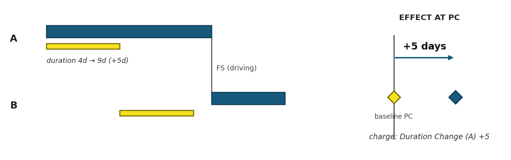

**What happens.** Activity A's planned duration grows from 4 to 9 working days. Its finish-to-start successor B is pushed the same 5 days, and the delay flows through unbroken logic to Practical Completion.

**How it's charged.** All 5 days go to **Duration Change**, against A. A's window closes when it drives B's start, and from there B only carries the date forward.

| Duration | Relationship | Constraint | Progress | Implied Logic | Fragnet/New | Levelling | Calendar | Δ PC |
|---|---|---|---|---|---|---|---|---|
| A +5 | – | – | – | – | – | – | – | **+5** |

### S02: Duration reduction (mitigation)

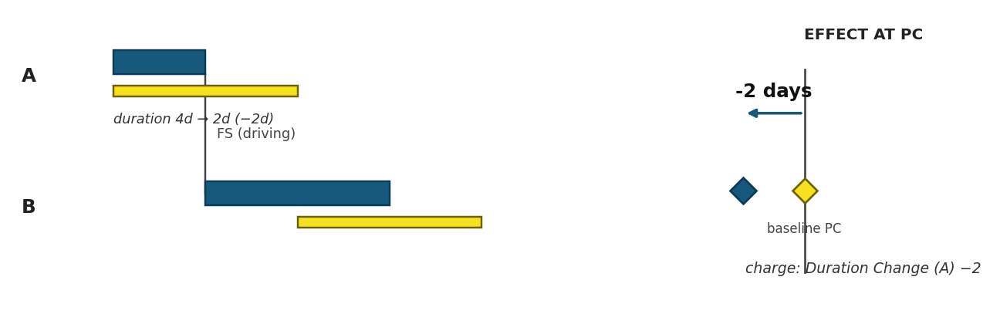

**What happens.** Activity A's duration is cut from 4 to 2 days. B moves 2 days earlier, and Practical Completion improves by 2 days.

**How it's charged.** **Duration Change** against A, as a negative value. Gains have to be recorded as carefully as delays, because over a reporting period the positives and negatives must add up to the real net movement.

| Duration | Relationship | Constraint | Progress | Implied Logic | Fragnet/New | Levelling | Calendar | Δ PC |
|---|---|---|---|---|---|---|---|---|
| A −2 | – | – | – | – | – | – | – | **−2** |

### S03: Late start with logic satisfied

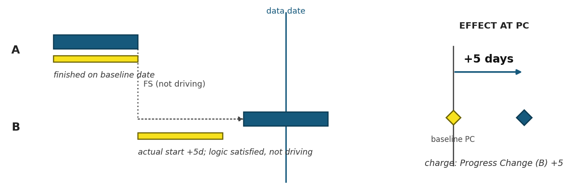

**What happens.** A finishes exactly on its baseline date, and its finish-to-start link to B is fully satisfied, yet B's actual start is 5 days later than planned. Nothing in the logic, constraints or durations explains the gap.

**How it's charged.** **Progress Change** against B. When actual dates move and nothing in the schedule's mechanics explains it, the delay belongs to that activity's own performance.

| Duration | Relationship | Constraint | Progress | Implied Logic | Fragnet/New | Levelling | Calendar | Δ PC |
|---|---|---|---|---|---|---|---|---|
| – | – | – | B +5 | – | – | – | – | **+5** |

### S04: Slow progress after an on-time start

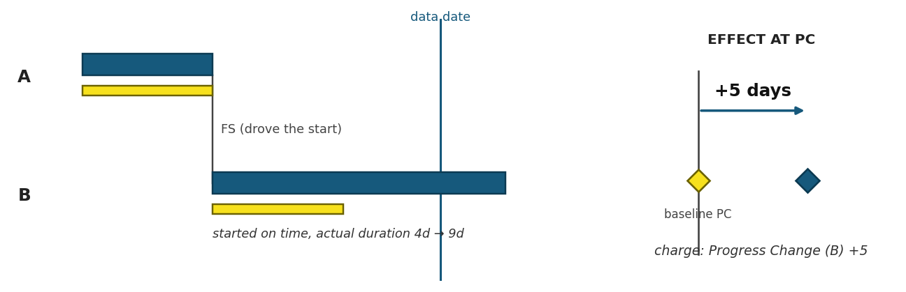

**What happens.** B starts exactly on its baseline date but takes 9 days instead of the planned 4. The longer bar pushes everything downstream by 5 days.

**How it's charged.** **Progress Change** against B, not Duration Change. Duration Change is an edit to the *plan*, where someone revised the duration in the schedule. Progress Change is what happened on site. The bar chart looks the same, but the cause is different.

| Duration | Relationship | Constraint | Progress | Implied Logic | Fragnet/New | Levelling | Calendar | Δ PC |
|---|---|---|---|---|---|---|---|---|
| – | – | – | B +5 | – | – | – | – | **+5** |

### S05: Constraint added

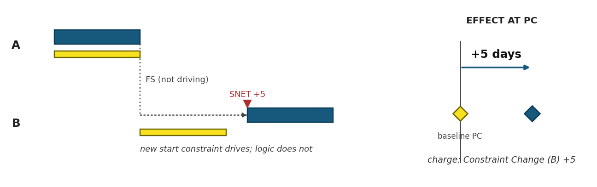

**What happens.** A Start-No-Earlier-Than constraint is applied to B, holding it 5 days after where its logic would place it. The constraint now controls B's start instead of the logic.

**How it's charged.** **Constraint Change** against B. Logic+ removes the constraint and recalculates, and the difference between the constrained and unconstrained dates is the charge. The upstream logic is charged nothing, because it was never what held B.

| Duration | Relationship | Constraint | Progress | Implied Logic | Fragnet/New | Levelling | Calendar | Δ PC |
|---|---|---|---|---|---|---|---|---|
| – | – | B +5 | – | – | – | – | – | **+5** |

### S06: Constraint removed

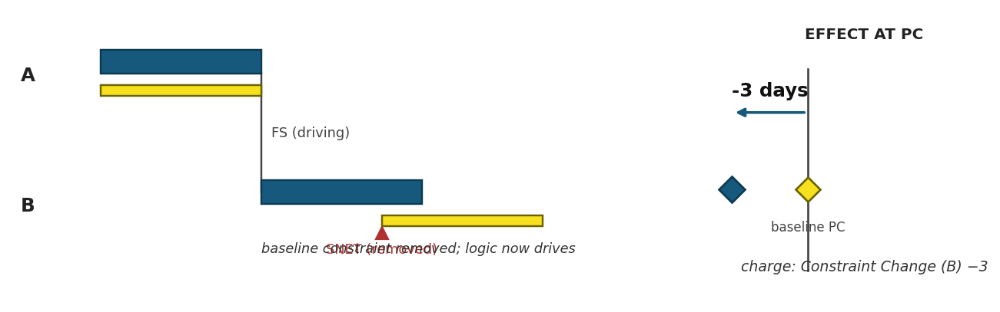

**What happens.** The baseline had a constraint holding B at a later date. The constraint is deleted, and B moves 3 days earlier, to its logic-driven date.

**How it's charged.** **Constraint Change** against B, as a negative value. This mirrors S05: constraints are charged for the delay they add and credited for the time they release.

| Duration | Relationship | Constraint | Progress | Implied Logic | Fragnet/New | Levelling | Calendar | Δ PC |
|---|---|---|---|---|---|---|---|---|
| – | – | B −3 | – | – | – | – | – | **−3** |

### S07: New relationship inserted

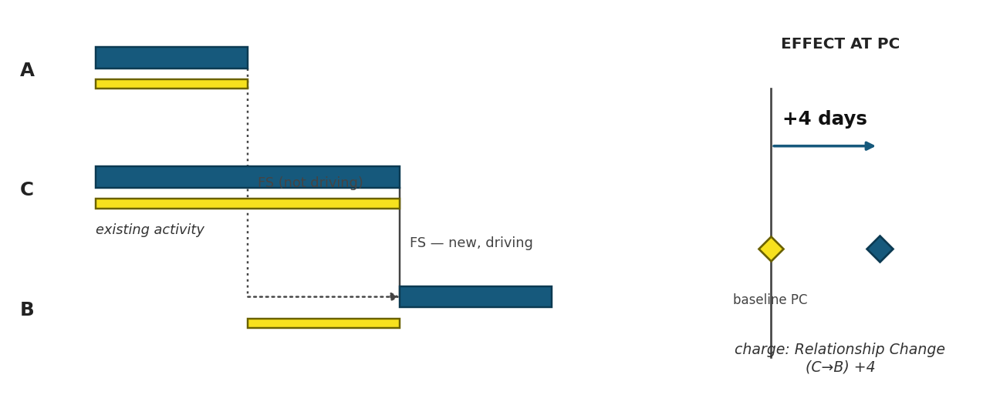

**What happens.** A new finish-to-start link is added from an existing activity C to B. C finishes later than A did, so B is now driven 4 days later than its baseline logic would place it.

**How it's charged.** **Relationship Change**, against the new C→B link. The charge is the difference between B's date under the old logic and under the new logic, with everything else held the same. C itself is charged nothing, because C didn't move; the link changed. The charge appears on B's row, the successor the link now governs, naming the link as the cause. Every relationship charge in this catalogue works this way.

| Duration | Relationship | Constraint | Progress | Implied Logic | Fragnet/New | Levelling | Calendar | Δ PC |
|---|---|---|---|---|---|---|---|---|
| – | B +4 | – | – | – | – | – | – | **+4** |

## Group 2 – When the relationship type changes the story

Each relationship type has its own hand-over point, where an activity's influence ends and passes downstream. This group follows that hand-over point closely: splitting a charge when logic only partly explains a movement, applying the driving test when a link isn't binding, and recording concurrency instead of forcing a single winner.

### S08: Lag increased on an existing link

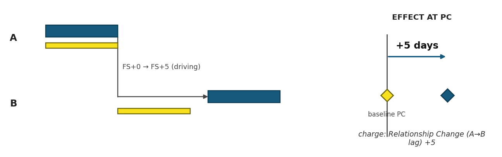

**What happens.** The A→B relationship keeps its type, but its lag is edited from 0 to +5 days. B is pushed 5 days without A moving at all.

**How it's charged.** **Relationship Change** against the A→B link. A lag edit is a logic edit, treated like inserting or deleting a relationship and measured as the change it produces.

| Duration | Relationship | Constraint | Progress | Implied Logic | Fragnet/New | Levelling | Calendar | Δ PC |
|---|---|---|---|---|---|---|---|---|
| – | B +5 | – | – | – | – | – | – | **+5** |

### S09: Relationship deleted

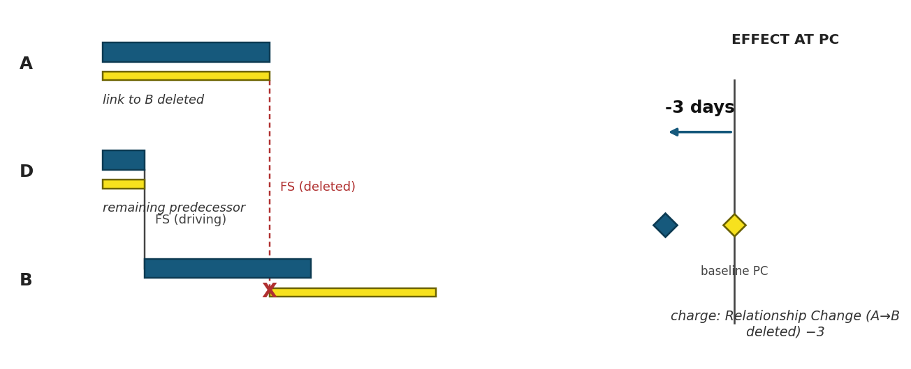

**What happens.** The A→B link is removed. B falls back on its remaining predecessor D and starts 3 days earlier than the baseline.

**How it's charged.** **Relationship Change**, as a negative value, against the deleted A→B link. It appears on B's row, because A never moved and isn't responsible for anything. If the deletion had left B with no predecessor at all, the case would move to Implied Logic instead (see [S19](#s19-implied-link)), because the schedule would no longer explain B's position.

| Duration | Relationship | Constraint | Progress | Implied Logic | Fragnet/New | Levelling | Calendar | Δ PC |
|---|---|---|---|---|---|---|---|---|
| – | B −3 | – | – | – | – | – | – | **−3** |

### S10: Start-to-start driving

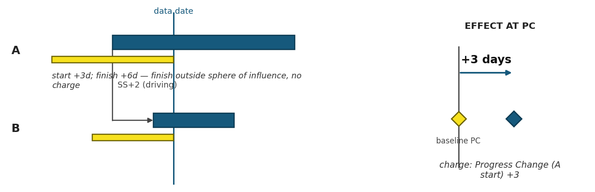

**What happens.** A drives B through a start-to-start link with 2 days of lag. A's actual start slips 3 days, which pushes B's start by 3 days too. A's own finish also slips by 6 days, but nothing downstream depends on A's finish.

**How it's charged.** **Progress Change** against A, for 3 days only, not 6. Under a start-to-start link, A's influence is limited to its *start*, and once B's start is driven, A's part is over. A's finish falls outside its window and is charged zero, however bad it looks on the bar chart. This is the clearest example of the window-of-influence rule.

| Duration | Relationship | Constraint | Progress | Implied Logic | Fragnet/New | Levelling | Calendar | Δ PC |
|---|---|---|---|---|---|---|---|---|
| – | – | – | A +3 | – | – | – | – | **+3** |

### S11: Finish-to-finish driving

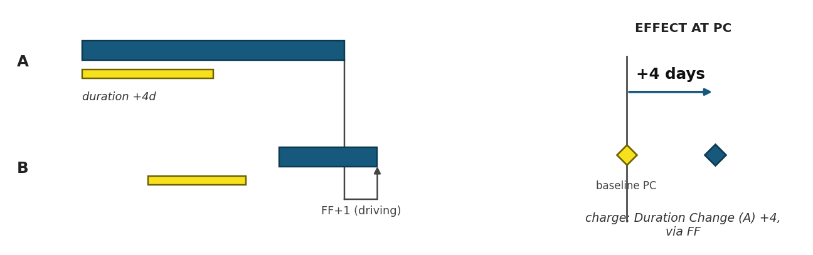

**What happens.** A drives B's finish through a finish-to-finish link with 1 day of lag. A's duration grows by 4 days, and B's finish moves 4 days later with it.

**How it's charged.** **Duration Change** against A, passed on through the FF link. This mirrors S10: here A's window closes at its *finish*, and B's start isn't part of the driven chain.

| Duration | Relationship | Constraint | Progress | Implied Logic | Fragnet/New | Levelling | Calendar | Δ PC |
|---|---|---|---|---|---|---|---|---|
| A +4 | – | – | – | – | – | – | – | **+4** |

### S12: Split attribution

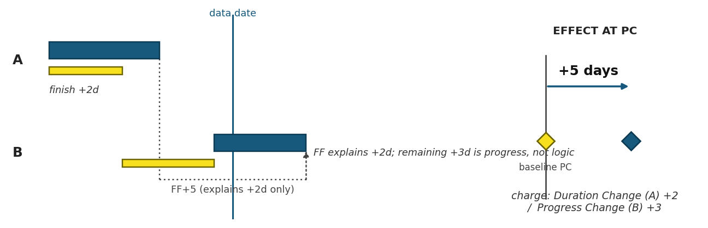

**What happens.** A→B is finish-to-finish with 5 days of lag. A's finish slips 2 days, moving B's required finish 2 days later. But B's actual start is 5 days later than planned, and the FF logic explains only 2 of those days. Nothing in the logic explains the other 3.

**How it's charged.** The charge is split: 2 days to A's cause (here, Duration Change), passed on through the link, and 3 days to **Progress Change** against B. Every partial explanation in the catalogue follows this rule: the logic is charged for exactly what it proves, and the unexplained rest goes to Progress Change. No category absorbs movement it can't account for.

| Duration | Relationship | Constraint | Progress | Implied Logic | Fragnet/New | Levelling | Calendar | Δ PC |
|---|---|---|---|---|---|---|---|---|
| A +2 | – | – | B +3 | – | – | – | – | **+5** |

### S13: Concurrent drivers

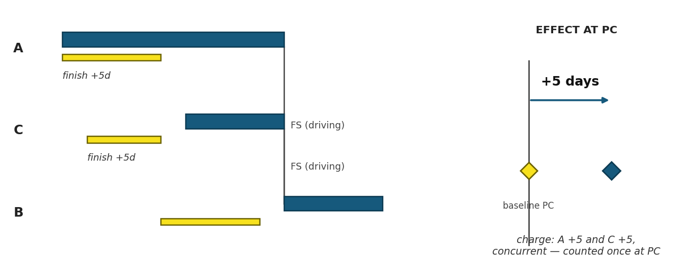

**What happens.** A and C both finish 5 days late, and both drive B through finish-to-start links. On the recalculated dates, the two drivers tie exactly.

**How it's charged.** Each concurrent driver carries the **full** charge, A +5 *and* C +5, both flagged as concurrent. At Practical Completion the movement is counted once: the two entries are alternative explanations of the same 5 days, not 10 days of delay, so a concurrent set is counted once before the columns are added up. This matters for a real delay claim, because recording the full charge against each driver keeps the fact that either one alone fully explains the movement. Splitting the charge in half, or picking a winner, would claim a certainty the schedule data doesn't support.

| Duration | Relationship | Constraint | Progress | Implied Logic | Fragnet/New | Levelling | Calendar | Δ PC |
|---|---|---|---|---|---|---|---|---|
| – | – | – | A +5\* / C +5\* | – | – | – | – | **+5** |

*\* Concurrent: the full +5 is recorded against each driver and counted once at PC, never added together.*

### S14: Absorbed by float

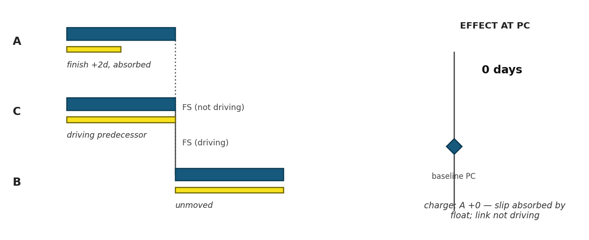

**What happens.** A slips 2 days, but B is driven by C, and A's late finish still falls within A's own float. B doesn't move, and neither does PC.

**How it's charged.** A is charged **zero**. Only movement on the driving path is chargeable: the driving test runs at every step, and a relationship that isn't binding passes nothing on. This scenario guards against the most common overclaim in delay analysis, which is treating every activity that ran late as if all its lateness reached completion.

| Duration | Relationship | Constraint | Progress | Implied Logic | Fragnet/New | Levelling | Calendar | Δ PC |
|---|---|---|---|---|---|---|---|---|
| – | – | – | – | – | – | – | – | **0** |

### S15: Start-to-finish

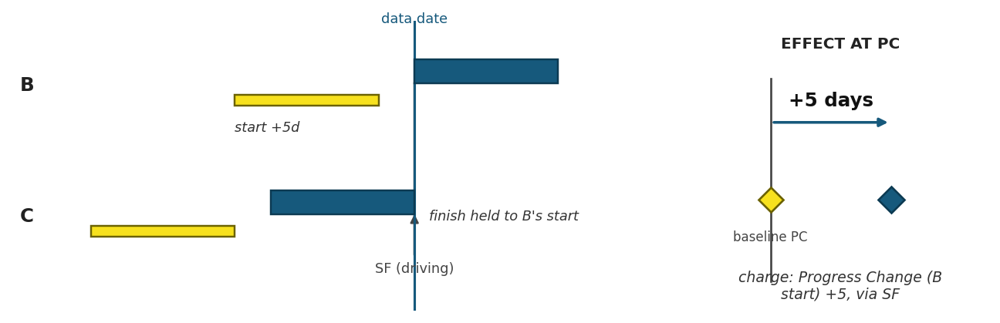

**What happens.** B→C is start-to-finish: C can't finish until B starts. B's start slips 5 days, which holds C's finish 5 days later.

**How it's charged.** To whatever caused B's start to move, here **Progress Change** against B, passed on through the SF link. Start-to-finish links are rare, and often a sign the logic could be modelled more cleanly, but the treatment still has to be defined: the hand-over runs from the predecessor's start to the successor's finish, and attribution follows it like any other link type.

| Duration | Relationship | Constraint | Progress | Implied Logic | Fragnet/New | Levelling | Calendar | Δ PC |
|---|---|---|---|---|---|---|---|---|
| – | – | – | B +5 | – | – | – | – | **+5** |

## Group 3 – When the network itself changes

This group covers fragnets, new activities, implied links and resource levelling: cases where the network has changed shape, or where the schedule no longer explains its own dates. Insertions are always measured by their before-and-after effect on Practical Completion, and implied links and levelling are always reported as candidates, never as proven causes.

### S16: Fragnet inserted, net effect zero

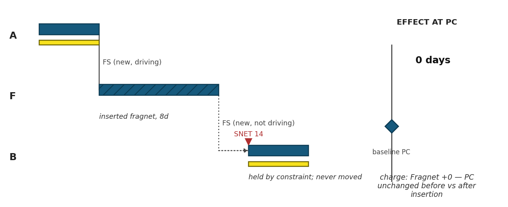

**What happens.** An 8-day fragnet F is inserted between A and B. But B is held by a Start-No-Earlier-Than constraint and had never moved off its baseline date, so the fragnet finishes well within B's existing wait. Practical Completion is the same before and after the insertion.

**How it's charged.** **Zero.** The rule is the before-and-after change at Practical Completion: recalculate PC without the fragnet and with it, and charge the difference, never the fragnet's own length. B's successors are now held in place by different logic, but because they hadn't moved off the baseline, the fragnet changed the *explanation* of the dates, not the dates themselves.

| Duration | Relationship | Constraint | Progress | Implied Logic | Fragnet/New | Levelling | Calendar | Δ PC |
|---|---|---|---|---|---|---|---|---|
| – | – | – | – | – | F 0 | – | – | **0** |

### S17: Fragnet inserted, partial push

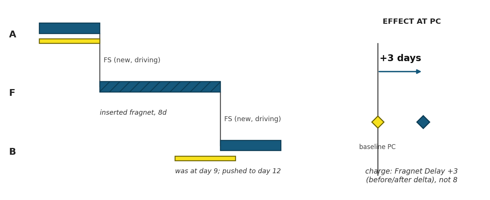

**What happens.** The same 8-day fragnet is inserted, but this time B was already at day 9, and the fragnet's day-12 finish pushes B by 3 days.

**How it's charged.** **Fragnet / New Activity**, +3, not +8. It uses the same before-and-after method as S16: the fragnet uses up whatever float and waiting time already existed downstream, and only the remaining movement at PC is charged to it. Charging fragnets by their length would consistently overstate their real effect.

| Duration | Relationship | Constraint | Progress | Implied Logic | Fragnet/New | Levelling | Calendar | Δ PC |
|---|---|---|---|---|---|---|---|---|
| – | – | – | – | – | F +3 | – | – | **+3** |

### S18: Single new activity inserted

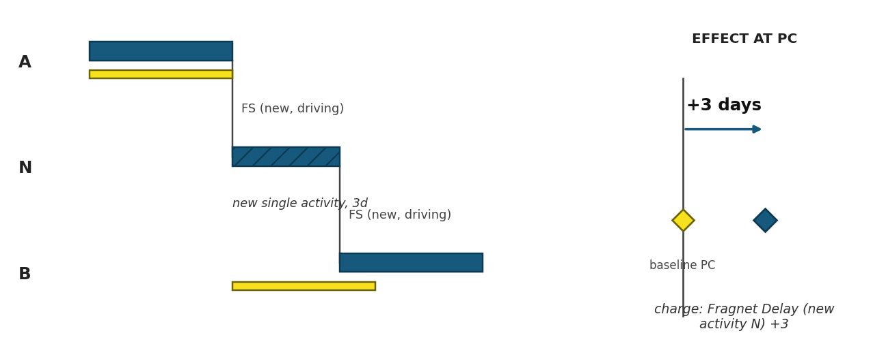

**What happens.** One new 3-day activity N is inserted into the A→B chain. B is pushed 3 days.

**How it's charged.** It's treated exactly like a fragnet of one activity, and charged to **Fragnet / New Activity** at the before-and-after change at PC. Here that equals N's full duration only because no float was available to absorb it.

| Duration | Relationship | Constraint | Progress | Implied Logic | Fragnet/New | Levelling | Calendar | Δ PC |
|---|---|---|---|---|---|---|---|---|
| – | – | – | – | – | N +3 | – | – | **+3** |

### S19: Implied link

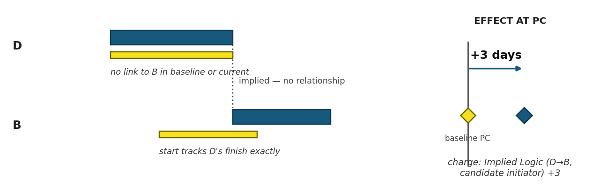

**What happens.** B has moved 3 days, and its new start tracks D's finish exactly, but there's no relationship between D and B in the baseline *or* the current schedule. Logic+ identifies D as the apparent driver from the pattern alone.

**How it's charged.** **Implied Logic**, labelled explicitly as a candidate initiator and never reported as a proven cause. The date correlation is evidence of something real, such as a shared crew, shared site access or an instruction that never made it into the schedule, but it's correlation, not proof, and the tool and any report have to keep that distinction clear. The charge measures what the implied link *would* explain if it turns out to be real; a person has to confirm it.

| Duration | Relationship | Constraint | Progress | Implied Logic | Fragnet/New | Levelling | Calendar | Δ PC |
|---|---|---|---|---|---|---|---|---|
| – | – | – | – | B +3 | – | – | – | **+3** |

### S20: Resource levelling *(not yet in Logic+)*

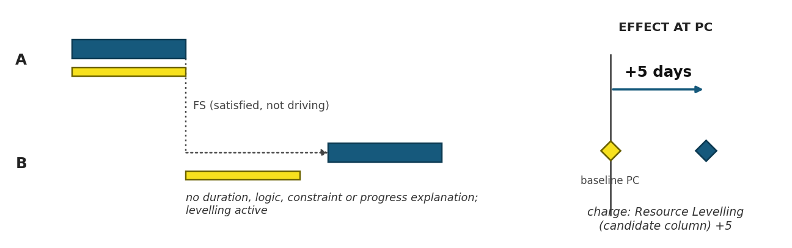

**What happens.** B is 5 days later than the baseline. Its logic is fully satisfied, there's no constraint, durations are unchanged, and the dates aren't actualised late, so every other category comes back empty. Resource levelling is switched on in the schedule, and B's resources were over-allocated in the period it moved out of.

**How it's charged.** **Resource Levelling**, but only by elimination plus corroboration. It's attributed here only when (a) no other category explains the movement, (b) levelling is switched on, *and* (c) a real resource conflict existed in the period B moved out of. Without (b) and (c), the remaining movement stays in Progress Change: every other category coming back empty is required, but never enough on its own. Like Implied Logic, this is a candidate attribution until it's confirmed against the levelling log.

| Duration | Relationship | Constraint | Progress | Implied Logic | Fragnet/New | Levelling | Calendar | Δ PC |
|---|---|---|---|---|---|---|---|---|
| – | – | – | – | – | – | B +5 | – | **+5** |

## Summary: all 20 scenarios at a glance

| ID | Scenario | Charged to | Δ PC |
|---|---|---|---|
| S01 | Duration extension on the driving path | A | +5 |
| S02 | Duration reduction (mitigation) | A | −2 |
| S03 | Late start with logic satisfied | B | +5 |
| S04 | Slow progress after an on-time start | B | +5 |
| S05 | Constraint added | B | +5 |
| S06 | Constraint removed | B | −3 |
| S07 | New relationship inserted | B | +4 |
| S08 | Lag increased on an existing link | B | +5 |
| S09 | Relationship deleted | B | −3 |
| S10 | Start-to-start driving | A | +3 |
| S11 | Finish-to-finish driving | A | +4 |
| S12 | Split attribution (finish-to-finish, partial) | A / B | +5 |
| S13 | Concurrent drivers | A & C | +5 |
| S14 | Absorbed by float | – | 0 |
| S15 | Start-to-finish | B | +5 |
| S16 | Fragnet inserted, net effect zero | F | 0 |
| S17 | Fragnet inserted, partial push | F | +3 |
| S18 | Single new activity inserted | N | +3 |
| S19 | Implied link | B | +3 |
| S20 | Resource levelling | B | +5 |

## The complete catalogue: 58 situations, five families *(reference)*

The 20 scenarios in the summary table are the foundation, and every situation in the full catalogue is a more specific version of one of them. The complete specification covers **58 situations**, grouped into five families. Logic+ applies S01–S19 and K-01 today (see [How the Traceback method works](pages/traceback-engine.md#worked-examples)). The rest, Resource Levelling above and the situations below, are **not yet in Logic+** and are set out here for reference, each with a diagram and explanation, by family.

Each family is collapsed by default, so expand the ones you need.

<strong>Family A — What changed (34 situations)</strong>

These are the ways a schedule can differ from its baseline, in both directions, and every other family builds on them. Each situation belongs to exactly one category, and gains are always recorded as negative charges, so the columns add up to the real movement at PC.

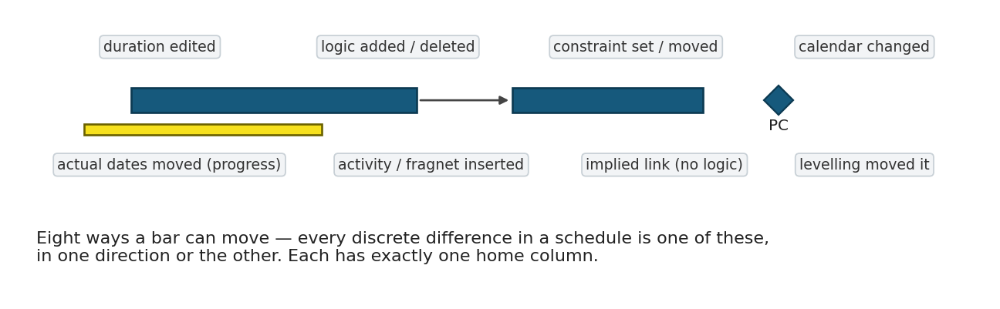

| ID | Situation | Treatment | Builds on |
|---|---|---|---|
| A-01 | Original duration increased | Full recalculated delta to Duration Change | S01 |
| A-02 | Original duration decreased | Negative Duration Change; gains recorded explicitly | S02 |
| A-03 | Remaining duration increased (work in progress) | Duration Change on the remaining portion only — the actualised portion is untouched | S01 |
| A-04 | Remaining duration decreased | Negative Duration Change on the remaining portion | S02 |
| A-05 | Relationship added, driving | Relationship Change at the recalculated delta | S07 |
| A-06 | Relationship added, non-driving | Recorded against the link, charged zero (driving test) | S14 |
| A-07 | Relationship deleted, successor re-driven earlier | Negative Relationship Change | S09 |
| A-08 | Relationship deleted, no driver left | Escalates to Implied Logic — the schedule no longer explains the successor's position | S09 → S19 |
| A-09 | Lag increased on an existing link | Relationship Change | S08 |
| A-10 | Lag decreased | Negative Relationship Change | S08 (mirror) |
| A-11 | Relationship type changed (e.g. FS → SS) | Treated as delete-plus-add; net recalculated delta | S07 + S09 |
| A-12 | Start-side constraint added or pushed later | Constraint Change | S05 |
| A-13 | Start-side constraint removed or relaxed | Negative Constraint Change | S06 |
| A-14 | Finish-side constraint added or tightened | May create negative float instead of moving dates; only actual PC movement is charged | S05 |
| A-15 | Finish-side constraint removed | Negative Constraint Change where PC moves — mirror of A-14 | S06 |
| A-16 | Mandatory constraint added | Constraint Change; overrides logic in both directions — suppressed logic is flagged, not charged | S05 |
| A-17 | Mandatory constraint removed | Constraint Change at the recalculated delta — mirror of A-16 | S06 |
| A-18 | Late actual/forecast start, logic satisfied | Progress Change | S03 |
| A-19 | Early actual/forecast start | Negative Progress Change | S03 (mirror) |
| A-20 | Slow progress — actual duration longer than planned | Progress Change | S04 |
| A-21 | Fast progress | Negative Progress Change | S04 (mirror) |
| A-22 | Suspension/resume recorded on an activity | Progress Change for the suspended span | S04 |
| A-23 | Out-of-sequence progress | Progress Change; recalculated dates depend on the scheduling option in force | – |
| A-24 | Fragnet inserted, net zero at PC | Zero — before/after delta at PC | S16 |
| A-25 | Fragnet or chain inserted, push at PC | Fragnet Delay at the before/after delta, never face-value length | S17 |
| A-26 | Single new activity inserted | Treated as A-25 — a fragnet of one | S18 |
| A-27 | Activity deleted from the network | Negative Fragnet/New Activity at the before/after delta | S16 (mirror) |
| A-28 | Logic rewired around a WBS restructure | Net of the individual link edits, to Relationship Change | S07 + S09 |
| A-29 | Implied link, delay | Implied Logic — candidate initiator | S19 |
| A-30 | Implied link, gain | Negative Implied Logic, same candidate discipline | S19 (mirror) |
| A-31 | Resource levelling push | Resource Levelling, after the three-part test | S20 |
| A-32 | Resource levelling release | Negative Resource Levelling | S20 (mirror) |
| A-33 | Activity calendar reassigned (e.g. 5-day → 7-day) | Calendar Change at the recalculated delta | – |
| A-34 | Calendar body edited (holidays, exceptions) | Calendar Change; affects every activity on that calendar, charged via the driving path | – |

A-01, 02, 05, 07, 09, 12, 13, 18, 20, 24, 25, 26, 29 and 31 are the base scenarios in the summary table above (S01–S20). See [How the Traceback method works](pages/traceback-engine.md#worked-examples) for diagrams and worked treatment of the ones applied today. The others are below.

**A-03: Remaining duration increased.** B started on time and was actualised to the data date, then its remaining duration was edited from 2 to 7 days. The edit is a plan change, so it charges Duration, not Progress, even though the work is already under way.

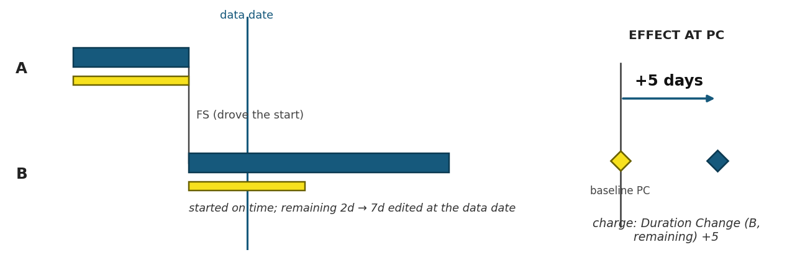

**A-04: Remaining duration decreased.** The same shape with the opposite sign: remaining work cut from 4 to 2 days.

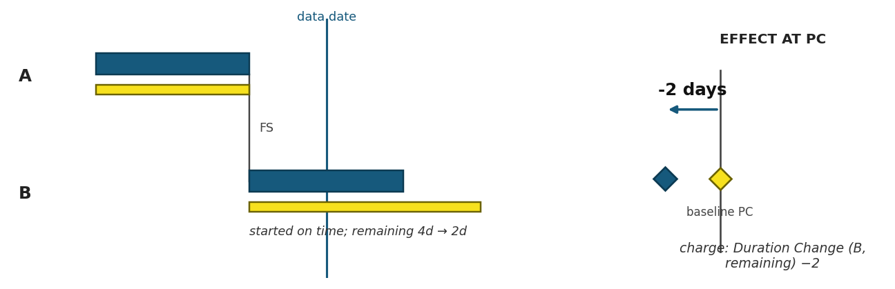

**A-06: Relationship added, non-driving.** A link was added from C, but C finishes within B's float. The schedule gained logic, not delay, so the link is recorded but charged zero.

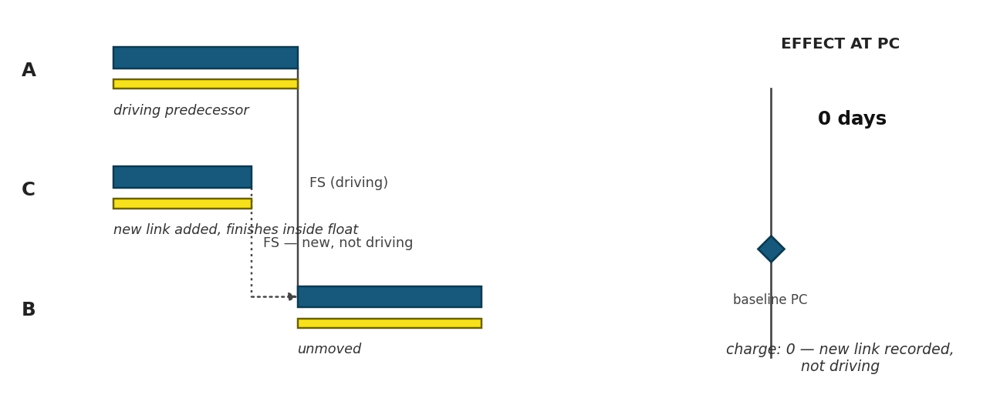

**A-08: Relationship deleted, no driver left.** The only link into B was deleted. Nothing in the schedule now explains B's position, so the case moves up a level: Logic+ identifies D as the candidate driver, and the charge goes to Implied Logic.

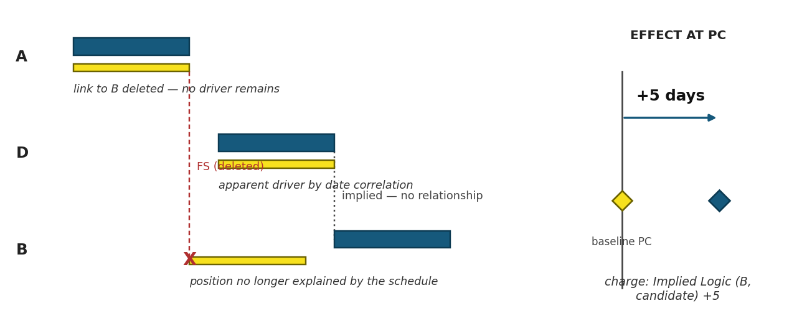

**A-10: Lag decreased.** The lag on A→B was cut from 3 days to 0, and B moves earlier. It's the gain equivalent of S08.

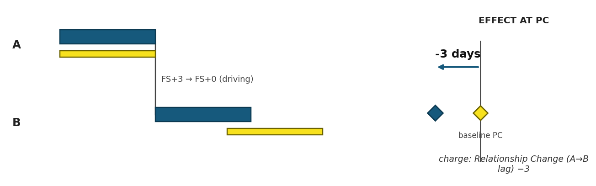

**A-11: Relationship type changed.** The relationship was edited from finish-to-start to start-to-start+1. It's measured as a deletion plus an addition and charged at the net change.

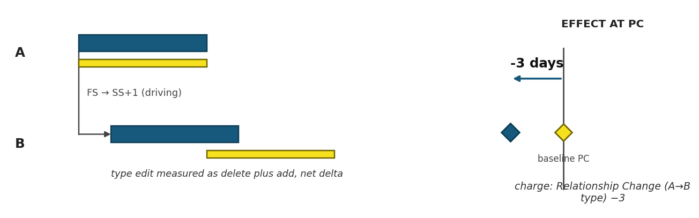

**A-14: Finish-side constraint added.** A Finish-No-Later-Than constraint was added. The dates don't move; total float goes negative instead. The pressure is flagged, but because nothing moved, the PC charge is zero.

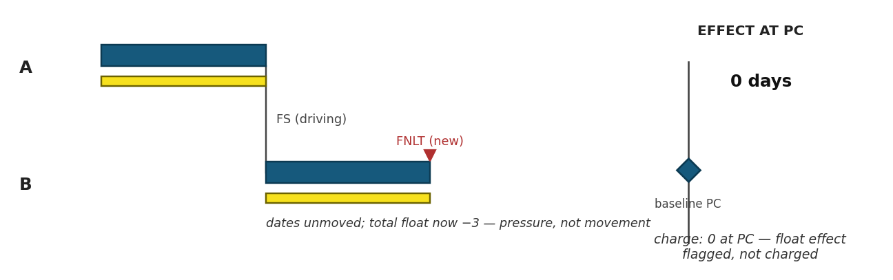

**A-16: Mandatory constraint added.** A Mandatory Start fixes B at day 9 regardless of the logic. The overridden link is shown dotted so the reader knows logic was overridden, but it isn't charged.

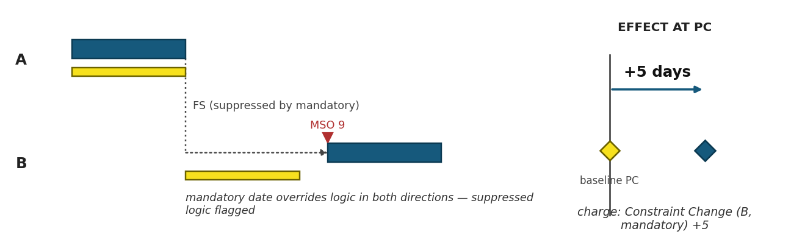

**A-19: Early actual or forecast start.** B started 2 days earlier than planned, with its logic satisfied. It's the gain equivalent of a late start, charged to Progress as a negative value.

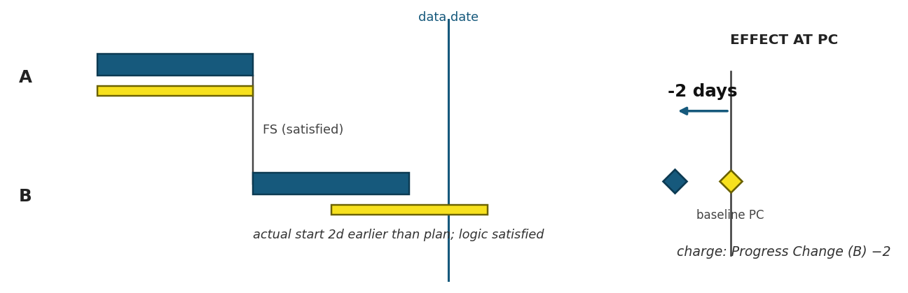

**A-21: Fast progress.** The activity started on time and finished in half the planned time: Negative Progress Change.

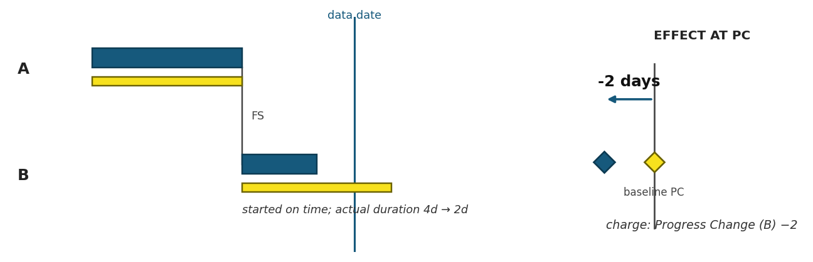

**A-22: Suspension and resume.** B worked for 2 days, stopped for 3, then resumed. The suspension lengthens the bar, and the suspended span is Progress Change.

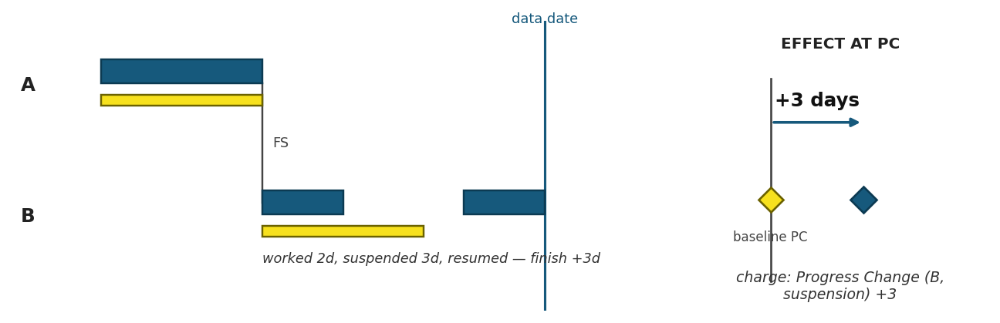

**A-23: Out-of-sequence progress.** B started before A finished, so work on site got ahead of the logic. The overridden link is shown dotted, and the recalculated effect depends on the scheduling option in force (see P-02 and P-03 in Family P below).

**A-27: Activity deleted.** B was deleted outright, leaving a yellow baseline bar with no blue bar above it. Its successor rewires and moves earlier, and the credit is recorded against the deleted activity at the before-and-after change.

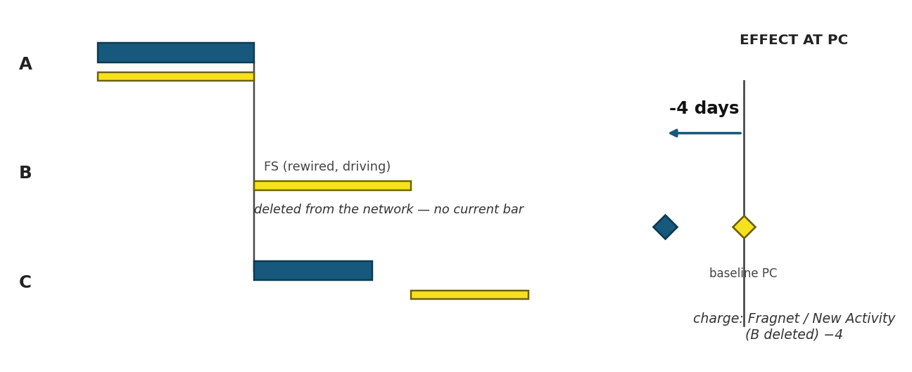

**A-28: Logic rewired in a WBS restructure.** One link was deleted and another added in a single restructure. The charge is the net of the two edits, recorded on B with both links named.

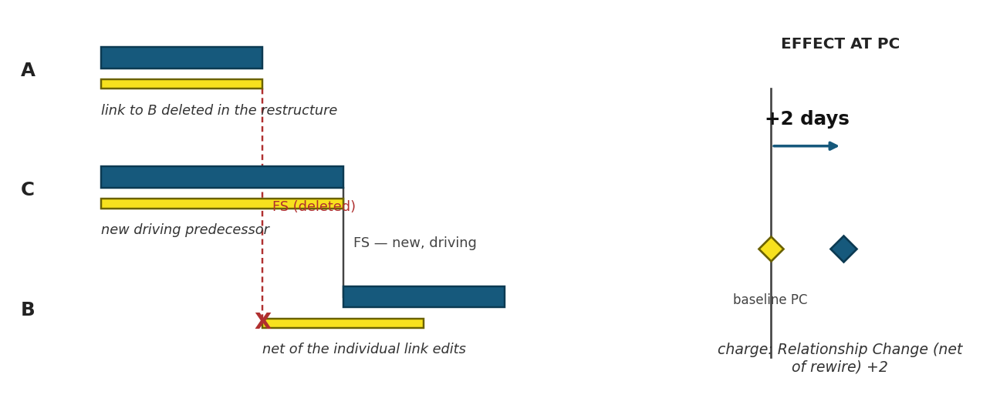

**A-30: Implied link, gain.** B sits 3 days earlier than anything in the schedule explains, tracking D's finish exactly. It's the gain equivalent of S19, and is likewise reported only as a candidate.

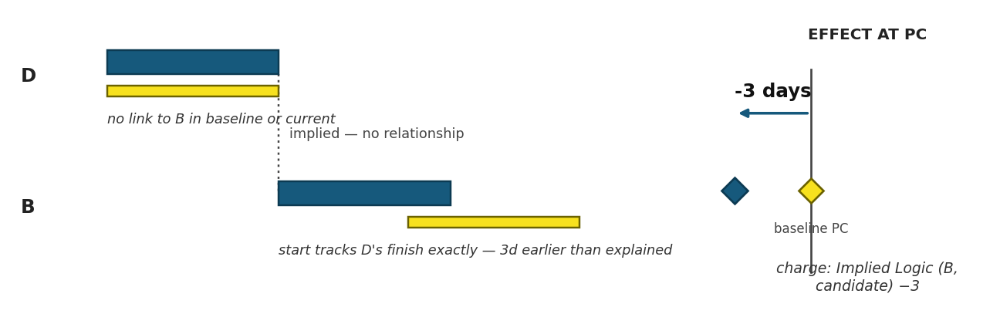

**A-32: Resource levelling release.** The conflict that held B late in the baseline was resolved, and levelling moves B earlier: Negative Resource Levelling, subject to the same three-part test as S20.

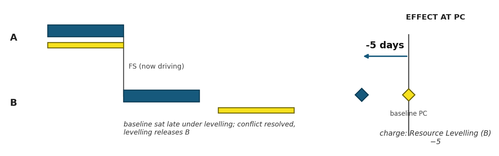

**A-33: Activity calendar reassigned.** B moved from a 5-day to a 7-day calendar, so the same work takes two fewer elapsed days. This is the core case for the Calendar Change category.

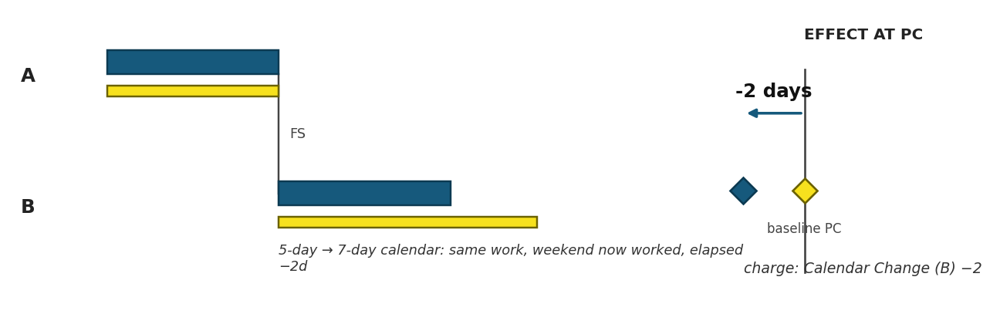

**A-34: Calendar body edited.** Two holidays were added to B's calendar. The activity itself wasn't edited, but it takes two more elapsed days, and every other activity on that calendar is affected the same way.

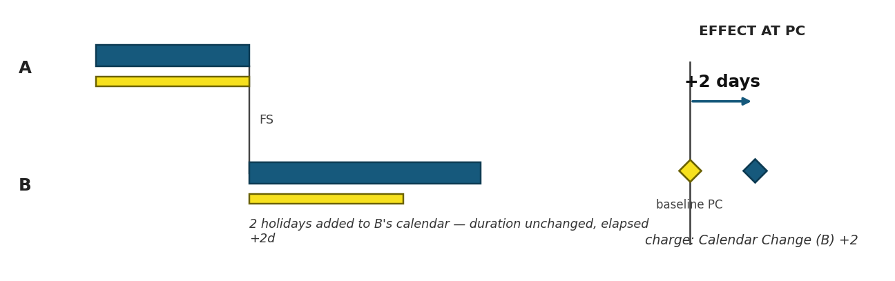

<strong>Family T — How delay travels to completion (12 situations)</strong>

What caused a delay, and how it reaches Practical Completion, are two separate questions answered in turn. Delay moves along the driving path, the hand-over point depends on the relationship type, and the charge reaches PC still attributed to where it started.

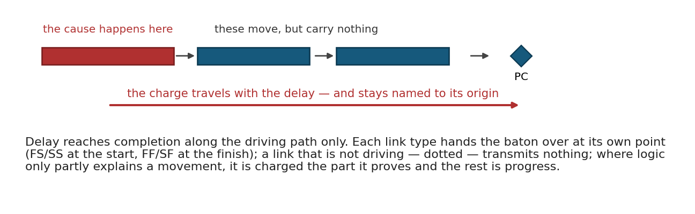

| ID | Situation | Treatment | Builds on |
|---|---|---|---|
| T-01 | Finish-to-start driving | Hand-over at the successor's start | S01 |
| T-02 | Start-to-start driving | Window closes at the start; predecessor's finish performance is charged zero | S10 |
| T-03 | Finish-to-finish driving | Hand-over at the finish; successor's start is outside the driven chain | S11 |
| T-04 | Start-to-finish driving | Predecessor start to successor finish; rare but defined | S15 |
| T-05 | Partial explanation | Split: logic charged what it proves, residual to Progress Change | S12 |
| T-06 | Non-driving link, float absorption | Zero charge — only the binding path transmits | S14 |
| T-07 | Concurrent drivers, exact tie | Full charge against each driver; counted once at PC | S13 |
| T-08 | Near-concurrency within a threshold | Flagged as near-concurrent, so a small recalculation difference can't silently flip the story | – |
| T-09 | Multi-hop relay through several activities | The charge stays with the originating cause, however many activities it passes through | S01 |
| T-10 | Redundant parallel links to one successor | The binding link is identified; the others are recorded as non-driving | S14 |
| T-11 | Driving path switches mid-window | Sequential split — each cause charged for the sub-period it actually drove | S12 |
| T-12 | Gain blocked by a secondary path | Mitigation charged only for the PC movement actually achieved | S02 |

T-01 to T-07 are the base scenarios in the summary table above (S01, S10, S11, S15, S12, S14, S13). The others are below.

**T-08: Near-concurrency.** C finishes one day after the driver, A. On the numbers A drives, but in practice it's too close to call. The near-concurrency flag records how close it was, so a one-day difference in recalculation can't quietly change the result.

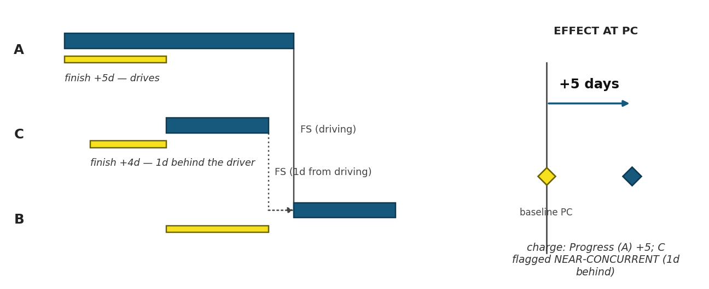

**T-09: Multi-hop relay.** A's 3-day extension passes through B and C. They both move, but the charge doesn't: it reaches PC still attributed to A. This keeps each activity's total meaningful across long chains.

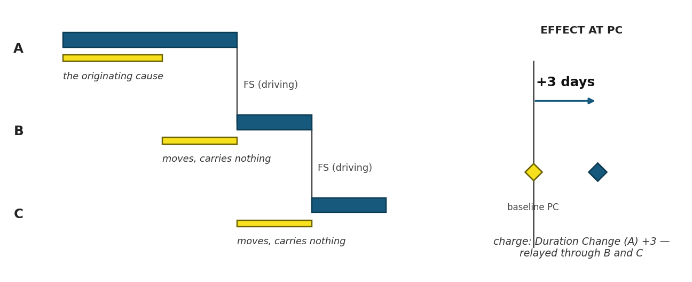

**T-10: Redundant parallel links.** Two links reach B, but only A's link binds. The other link is recorded, so the network history stays complete, but it's charged nothing.

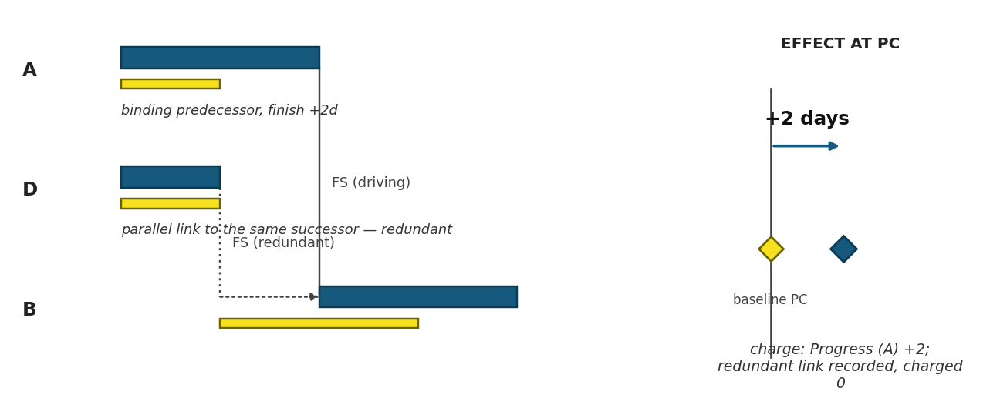

**T-11: Driving path switches mid-window.** A drove the first 2 days of B's movement, then a new constraint took over and drove 3 more. One window has two drivers in turn, so the charge is split by sub-period instead of being given to a single winner.

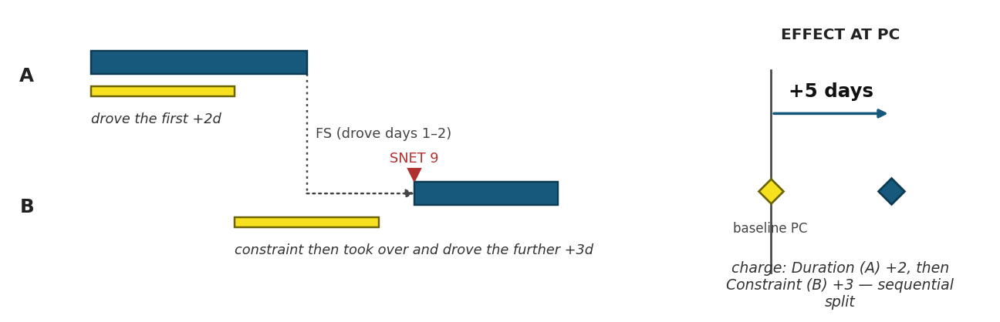

**T-12: Gain blocked by a secondary path.** A gained back 3 days of duration, but C never moved and is still the driver, so the gain never reached Practical Completion. Mitigation is credited only for the completion movement it achieved, which here is zero.

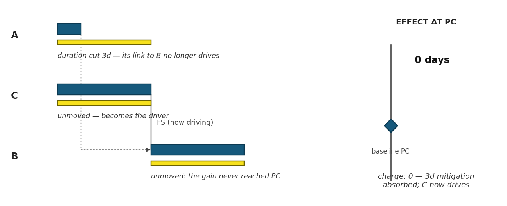

<strong>Family P — Work already underway (5 situations)</strong>

Once an activity is in progress, the same edit can mean two different things, and the data date is the dividing line. These five situations are the ones where the state of the work changes how it's read.

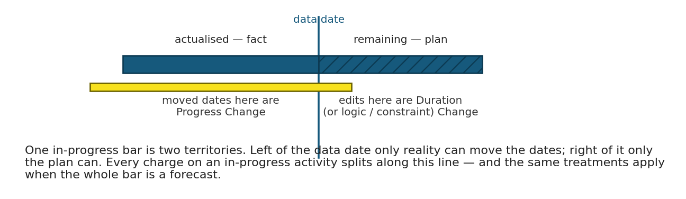

| ID | Situation | Treatment | Builds on |
|---|---|---|---|
| P-01 | In-progress bar: actual start plus revised remaining | One bar splits two ways — the actualised portion is Progress Change, the remaining-duration edit is Duration Change | S01 vs S04 |
| P-02 | Retained logic vs. progress override | The scheduling option changes the recalculated dates themselves; the option in force is recorded with every charge | – |
| P-03 | Out-of-sequence progress | Successor started before its logic was satisfied; treatment depends on the scheduling option, charged to Progress Change | – |
| P-04 | Completed activity, later logic edits | The window has closed — edits to logic on completed work charge zero at PC | – |
| P-05 | Prospective symmetry | Identical treatments apply to forecast bars; the language is always "forecast," never "as-built" | – |

**P-01: Actual start plus revised remaining.** One bar has two parts. The 2-day late start is a matter of record and charges Progress, and the remaining-duration edit from 2 to 5 days is a plan change and charges Duration. The data date divides them.

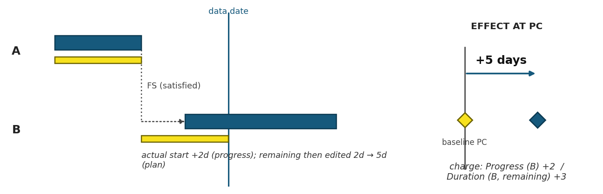

**P-02: Retained logic vs. progress override.** B started out of sequence while A still had work outstanding. "Retained logic" and "progress override" are scheduling options that forecast different dates from the same facts, so the option in force is always recorded with the charge. Otherwise, two runs of the tool could disagree with no visible reason.

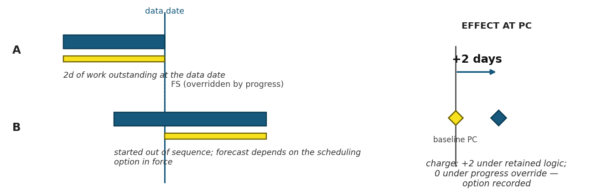

**P-03: Out-of-sequence progress.** Work on site got ahead of the logic. The gain is Progress Change, the overridden link is shown dotted, and the recalculation follows P-02's rule.

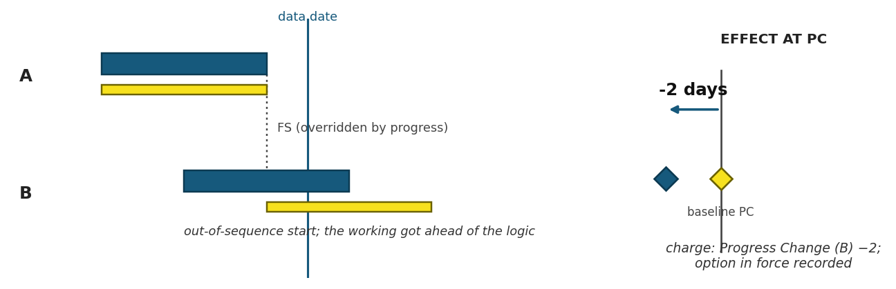

**P-04: Completed activity, later logic edits.** Both activities are complete. A lag edit on their link changes nothing, because actualised dates can't move and the window has already closed, so the edit charges zero.

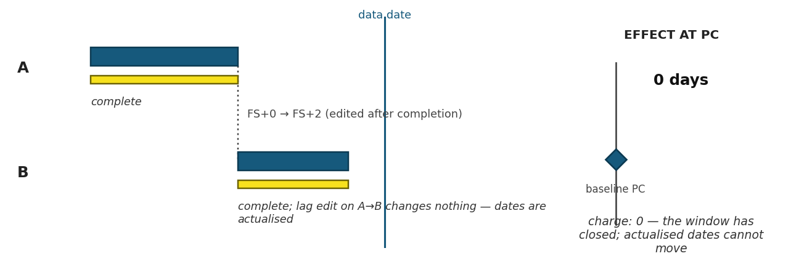

**P-05: Prospective symmetry.** The whole network is ahead of the data date, so every bar shown is a forecast. The treatment is the same as S01; only the wording changes, from "as-built movement" to "forecast movement".

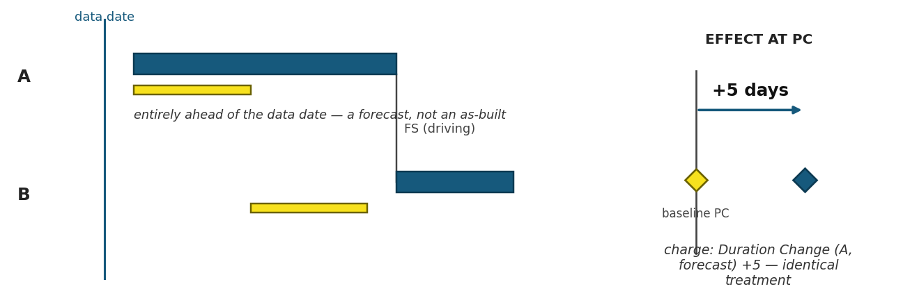

<strong>Family K — Counting the days (3 situations)</strong>

The same delay can be a different number of days on a different calendar, so before a charge is stated in days, Logic+ has to know *whose* days it's counting. Three rules decide this.

| ID | Situation | Treatment | Builds on |
|---|---|---|---|
| K-01 | Cross-calendar day-count translation | A delta crossing calendars is counted in the successor's calendar, from the hand-over point onward | – |
| K-02 | PC milestone calendar | Movement at PC is always measured on the PC milestone's own calendar | – |
| K-03 | Calendar vs. levelling — telling them apart | Both can move dates with every other category silent. The tiebreak: a calendar delta reproduces exactly from the calendar diff; levelling needs a corroborating resource conflict too | S20 |

**K-01: Cross-calendar translation** *(live, shown in the Delay explanation window)*. A runs on a 5-day calendar and B on a 7-day one. A's slip is handed over at the link and counted in B's days from that point on, so the delay is converted to B's calendar at the hand-over.

**K-02: The PC milestone's own calendar.** Activity days and milestone days can differ. Whatever calendars the delay crossed on its way through the schedule, the number reported at PC is always counted on the PC milestone's own calendar.

**K-03: Calendar vs. levelling.** B moved 2 days with every other category empty, which a calendar change and resource levelling can both produce. To tell them apart, recalculate the change against the calendar edits: if that reproduces the movement exactly, it's a Calendar Change. Levelling also needs a resource conflict in the period B moved out of.

<strong>Family X — Several changes at once (4 situations)</strong>

This family covers two or more causes affecting the same activity in one reporting window. Instead of a diagram for every combination, it uses a fixed order: the causes are separated out one at a time, always in the same sequence, and the pieces must add back exactly to the real movement at PC.

| ID | Situation | Treatment | Builds on |
|---|---|---|---|
| X-01 | Constraint plus duration change, same window | Extract the constraint effect first, then the duration effect — the residual must reconcile | – |
| X-02 | Logic edit plus progress, same window | Logic extracted first; the unexplained residual goes to Progress Change | – |
| X-03 | Fragnet insertion plus successor progress, same window | The before/after delta is computed with the progress movement isolated, so the fragnet isn't charged for performance it didn't cause | S16/S17 |
| X-04 | The general ordering rule | Constraints → logic → durations → progress residual, every time; the signed sum of all four equals the movement at PC | – |

**X-01: Constraint plus duration.** A new constraint and a duration edit happened in the same reporting window. The constraint is separated out first (+3), then the duration (+2), and the two add up exactly to the +5 at PC.

**X-02: Logic edit plus progress.** A lag edit explains 2 of the 5 days of movement, and the other 3 have no logic explanation, so they go to Progress. Logic is always separated out first, and the remainder is never hidden inside a logic charge.

**X-03: Fragnet plus successor progress.** A fragnet was inserted while B also ran slow in the same window. The insertion's before-and-after change is calculated with B's progress separated out (+3), so the fragnet isn't charged for B's own performance (+2). The two causes have separate owners, and the total still adds up.

**X-04: The general ordering rule.** This is the rule behind the whole family: constraints first, then logic, then durations, with whatever is left going to Progress, and the signed pieces always adding up exactly to the real movement at PC.

