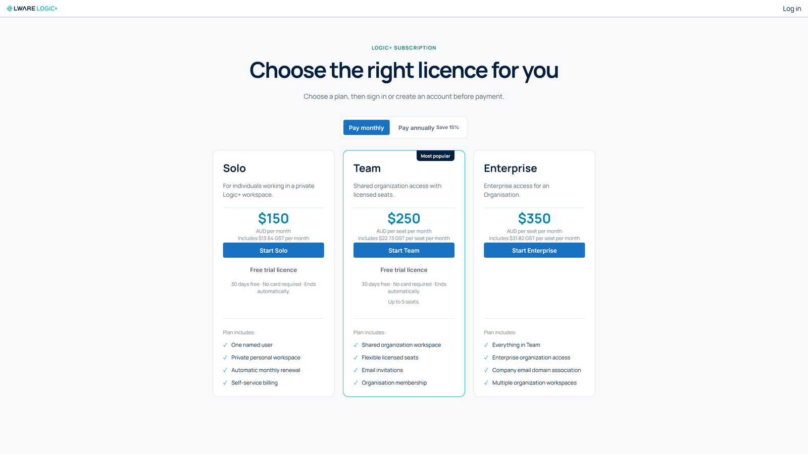
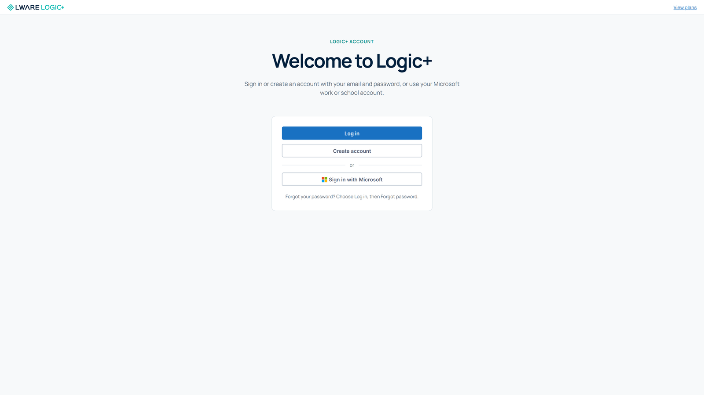
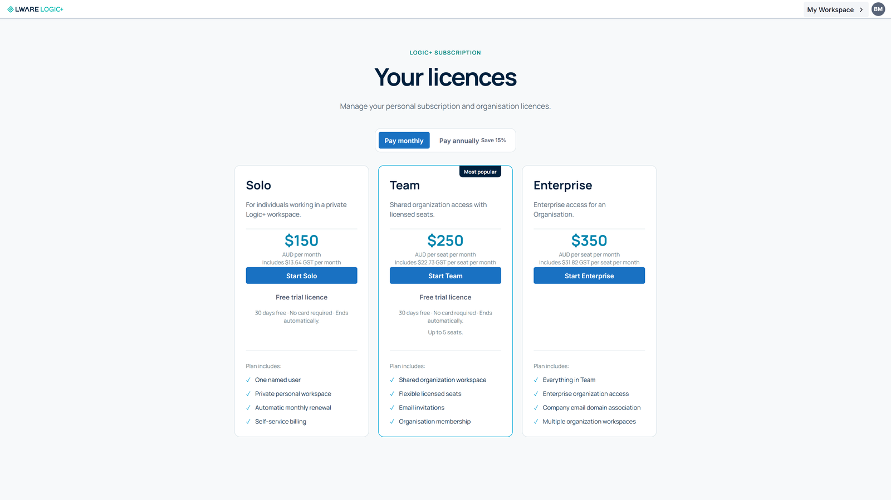
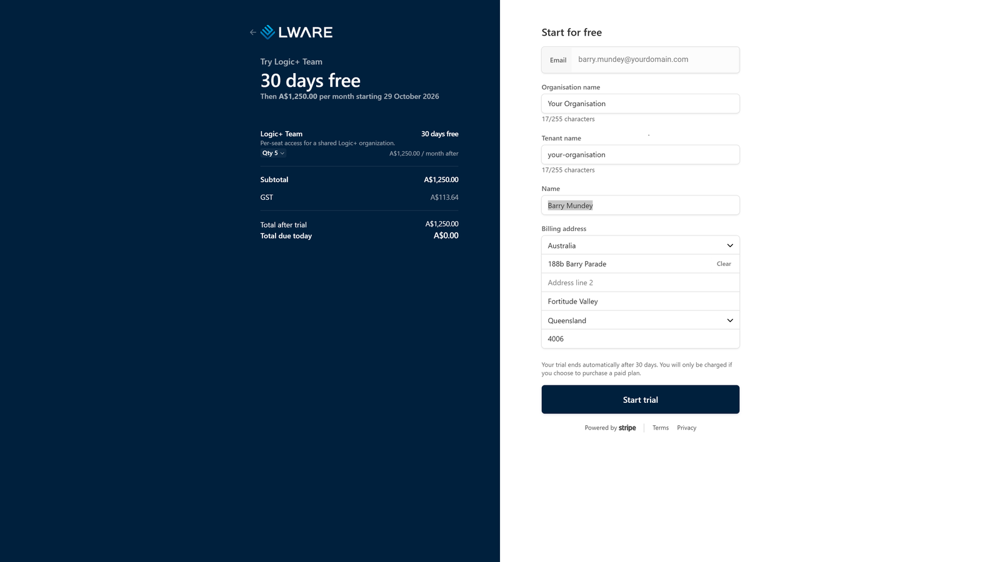
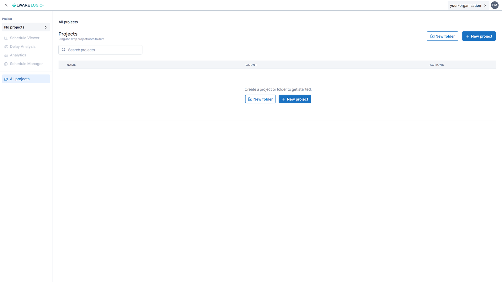

## Overview

Logic+ Online has three licences – **Solo**, **Team**, and **Enterprise** – covering everyone from an individual to a whole organisation with multiple licensed seats. Solo and Team can both be tried free for 30 days. Sign up for any of them online.

This is separate from being invited to an existing organisation's workspace, where an admin invites you by email and no signup is needed – see [Getting Started](guides/getting-started.md) for that path. See [Subscription & Billing](pages/subscription-billing.md) for how to manage seats and user licences once you're on a Team or Enterprise plan.

**Prefer to watch?** This short walkthrough covers signing up, then inviting your team. It plays automatically – use ◀ ▶, the dots, or click the slide to step through at your own pace:

<iframe src="pages/walkthroughs/signup/index.html" title="Sign up, subscription and user management walkthrough" style="width:100%;max-width:960px;aspect-ratio:16/10;border:1px solid #d9e0e6;border-radius:8px" loading="lazy"></iframe>

## Steps

### 1. Choose a licence

Go to **https://logicplus.smartcoro.com/licensing** and choose a licence type – **Free trial licence** to try Solo or Team, or **Start Solo** / **Start Team** / **Start Enterprise** to buy.

| Plan | Monthly price | Notes |
|---|---|---|
| Solo | $150 AUD/month | One named user, private personal workspace, automatic monthly renewal, self-service billing |
| Team | $250 AUD/seat/month | Shared organisation workspace, flexible licensed seats, email invitations, organisation membership |
| Enterprise | $350 AUD/seat/month | Everything in Team, plus enterprise organisation access, company email domain association, multiple organisation workspaces |

**Free trials.** The Solo and Team cards each have a **Free trial licence** button: 30 days, no card required, and the trial ends automatically – you're only charged if you choose to buy. You can have one Solo trial and one Team trial. A Team trial is for your organisation and starts with five seats. If you buy a plan during its trial, billing starts when the trial ends, not straight away. Enterprise doesn't have a self-service trial – contact **support@lware.com** if you'd like to evaluate it.

A **Pay annually** toggle switches every paid plan to annual billing at a 15% discount (billed as one annual charge rather than monthly). Every price shown already **includes GST** – there's no tax added on top at checkout, and each plan card shows exactly how much of its price is GST.

### 2. Create an account, or sign in with Microsoft

On the **Welcome to Logic+** screen, choose **Create account**, or **Sign in with Microsoft** if you have a Microsoft work or school account. (Already have a Logic+ account? Choose **Log in**.)

**Creating a new account:**

1. Enter your email address and click **Continue**.
2. Choose a password and click **Continue**. It needs at least 8 characters, including at least three of: lower-case letters, upper-case letters, numbers and special characters.
3. Check your email for a verification code, enter it, and click **Continue**. (No email? Click **Resend**.)
4. When asked to authorise the Logic+ application, click **Accept**.

**Signing in with Microsoft:**

1. Enter your Microsoft email address and click **Next**.
2. Review the permissions Logic+ is asking for, and click **Accept**.

### 3. Choose your licence again and check out

Once you're signed in, the **Your licences** page asks for your licence type again – choose the same plan.

At checkout:

1. For Team or Enterprise, set the number of **seats** (a Team trial includes up to five).
2. Enter your **organisation name**, a **tenant name** (the short name shown in the workspace selector at the top of Logic+), your **name** and your **billing address**.
3. Click **Start trial** (or the equivalent button for a paid plan). For a trial, the total due today is $0.

### 4. You're in

After checkout you're logged in to Logic+ Online automatically, in your new organisation's workspace. For Team or Enterprise, you're its **Owner**. **Save the link** so you can get back in later.

Next steps:

- Check you're in the right workspace before creating projects – see [Choosing a workspace](guides/getting-started.md#choosing-a-workspace).
- Invite your team – see [Managing seats](pages/subscription-billing.md#managing-seats).

## If you run into trouble

Contact **support@lware.com** with any issues, questions, or feedback.
