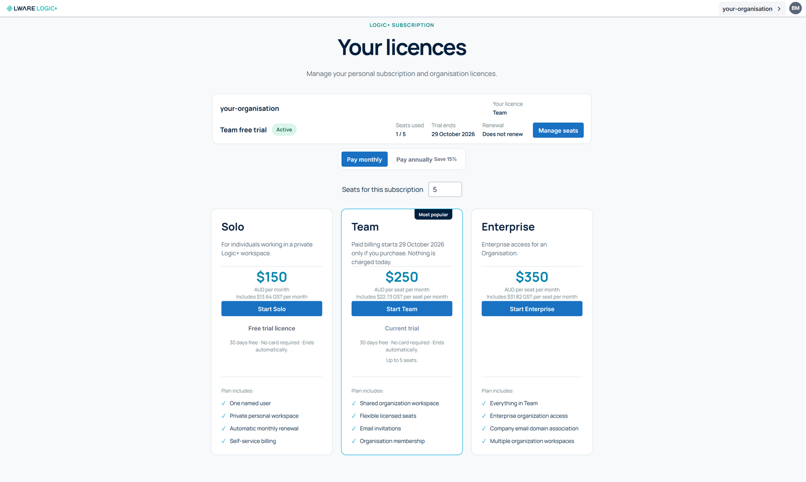
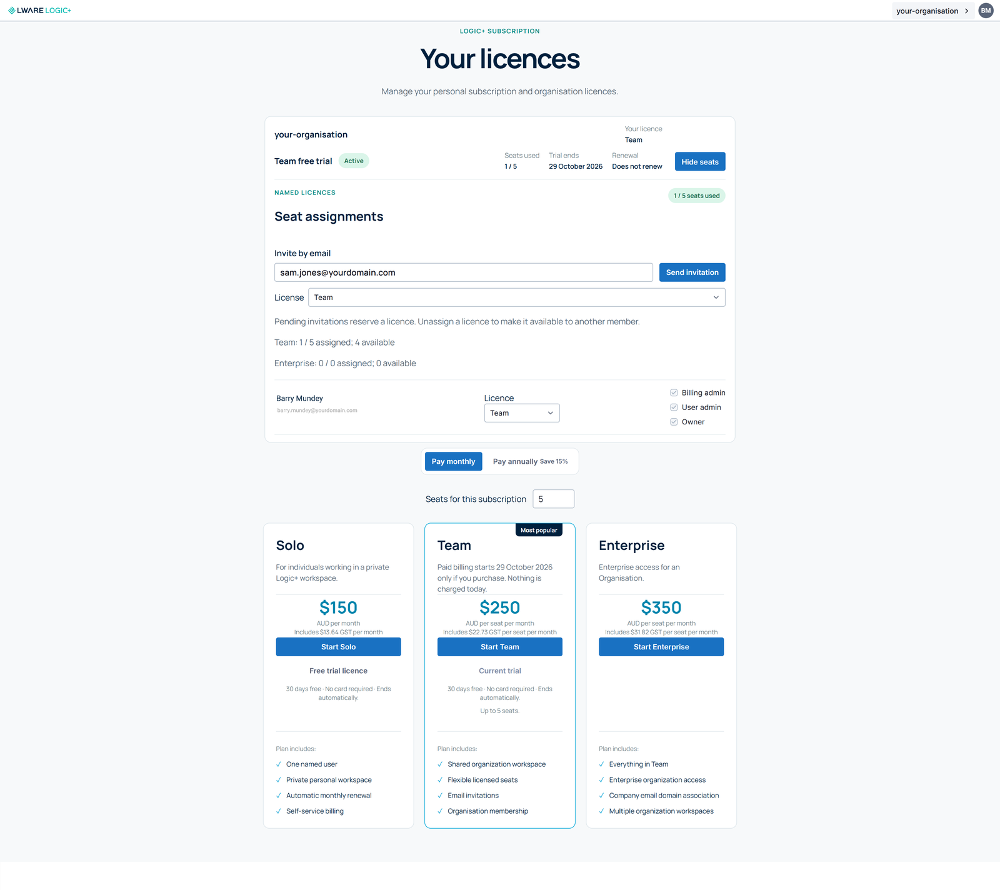
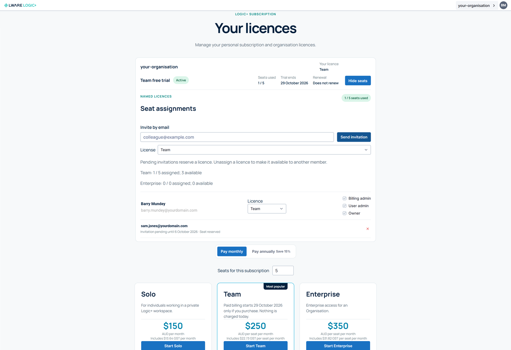
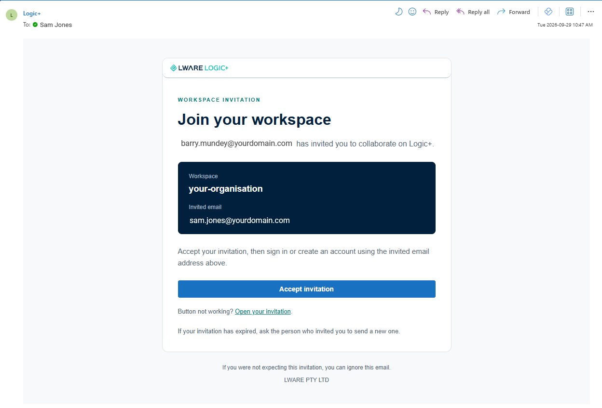
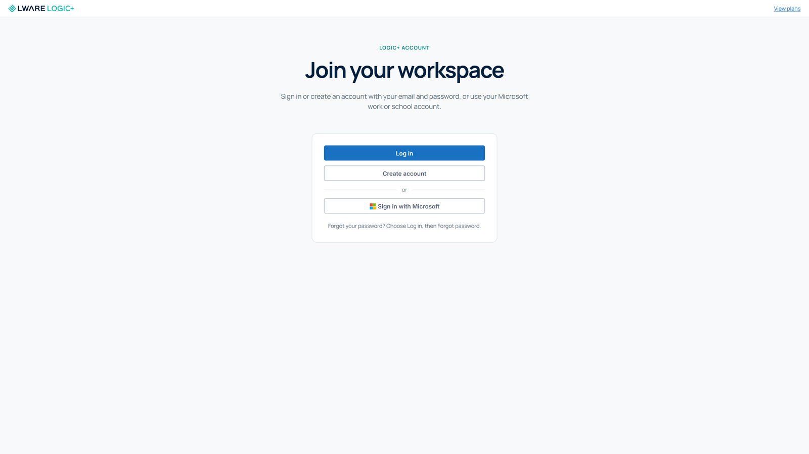

## About this page

Open **Subscription** from your profile menu (your initials, top right, below Settings) to manage your licences. The page's address is `/licensing`.

The page is headed **Your plans**. If you have no plan yet, it offers **Start a free trial** instead: see [signing up](pages/signing-up.md). The Logic+ website shows plans and prices; this page covers the plans you already have.

## The licensing model

Every organisation you belong to has its own licence, and so does your personal workspace:

- **Solo**: one named user with a private personal workspace. It's independent of any organisation, so you can buy or cancel it without affecting your organisation membership.
- **Team** and **Enterprise**: organisation plans with a fixed number of seats. An organisation can have both tiers at once, with some members on Team and others on Enterprise.

A **Team trial** is free for 30 days with five licences and no card required. See [Signing Up](pages/signing-up.md). It starts automatically and shows here as **Team free trial**. To keep going, click **Buy Team licences** beside it; buying replaces the trial.

**To use Logic+ under an organisation, a member needs exactly one named role, Team Licensed User or Enterprise Licensed User, and that tier needs an active subscription.** An active organisation subscription alone doesn't give you access. Someone still has to assign you a named licence (see [Managing seats](#managing-seats) below).

**Admin roles don't use a seat.** A member can hold an admin role with or without a named licence, and every admin role can open Subscription without one. An **About admin roles** panel on the page summarises them:

| Role | What it does |
|---|---|
| **App Owner** | Manages billing, seats and all projects, and can transfer app ownership. The only role that can change **Billing admin** and **User admin** assignments. There is one App Owner per organisation. |
| **Project Admin** | Manages all projects, and who else is a Project Admin. See [Permissions and Access](pages/permissions.md). App Owners can also change Project Admin assignments. Both roles can manage projects without holding a licence. |
| **Billing admin** | Manages organisation billing and purchases licences. |
| **User admin** | Invites and removes members and assigns licences. Can't change Billing admin or User admin assignments. |

The folder and project roles (**View**, **Edit**, **Owner**) are separate and apply only to the folder or project they're given on.

An organisation licence also covers your personal **My Workspace**, whose data stays separate from the organisation's projects.

## Your licences

For each workspace you belong to, this page shows:

| Field | Meaning |
|---|---|
| Plan | Solo, Team or Enterprise, with "free trial" added during a trial (for example **Team free trial**) |
| Status | **Active** or **Inactive** |
| Seats used | *(organisation plans only)* how many named licences are assigned, out of the total purchased |
| Trial ends / Paid through | The date your current period ends |
| Renewal | **Automatic**, **Cancels at period end**, **Does not renew** (a trial you haven't bought), or for example **Team starts when your trial ends** (a trial you've already bought) |

If your organisation's subscription isn't active and you're not a billing admin, you'll see a message asking you to contact a billing admin instead of the licence detail. If the organisation has an active subscription but you don't hold a named Team or Enterprise licence, a message says you need one to access projects, schedules, delay analysis and analytics. Administrators can still manage licences and seats in that case.

## Managing billing

**Manage billing** (**Manage Solo billing** for a Solo plan) opens the Stripe billing portal for that workspace. There you can change the number of seats, switch between monthly and annual billing, update your card and download invoices. The button appears only if you can manage billing for that workspace (the App Owner or a Billing admin), and not while you're still on a trial.

**Buy [plan] licences** links appear beside a trial or a cancelled plan. Billing admins also see them for any Team or Enterprise plan the organisation doesn't have yet. They take you to a Stripe checkout (see [Signing Up](pages/signing-up.md#4b-buying-a-plan)).

Changing seats in Stripe doesn't change who holds a licence. If you reduce the purchased seats below the number already assigned, existing assignments stay, but you can't assign or invite anyone else until capacity is available again.

## Managing seats

For an organisation plan, click **Manage seats** to open the **Manage Seats** panel, and **Hide seats** to close it. The **App Owner** and **User admin** see everything below. A **Project Admin** who is neither sees only the member list with the **Project Admin** checkbox, plus an **Open projects** link. Everyone else sees a disabled button that explains the permission needed. The panel shows:

- **Seats used**: a running count against your purchased capacity.
- **Invite by email**: enter an email address, choose a **Seat Type** (**No seat**, **Team** or **Enterprise**) and click **Send invitation**. The seat type defaults to **Team**, or to **Enterprise** if no Team seats are left. Choosing a tier reserves a seat straight away, before the invitation is accepted.
- **Availability per tier**: how many seats are assigned out of the total for each tier (for example *Team: 3 of 5 assigned*).
- **Member roster**: for each member, their **Seat Type**, their **Project Admin**, **Billing admin** and **User admin** checkboxes, an **App Owner** badge on the owner, and the buttons **Assign seat**, **Clear seat**, **Make owner** and **Remove user**. Change the seat type with the dropdown; a tier shows as unavailable once its seats are full, unless you're changing that member's existing seat. **Project Admin** is the organisation-wide folder and project access role: see [Permissions and Access](pages/permissions.md#for-app-owners-and-user-admins). The last Project Admin's checkbox is disabled, so make someone else one first. Only the App Owner can tick or untick **Billing admin** and **User admin**.
- **Pending invitations**: shown as **Invite pending**, with the date the invitation is valid until and the seat type it reserves, which you can change until it's accepted. **Revoke** cancels an invitation after a confirmation (*"The invitation for [email] will be revoked immediately. This cannot be undone."*). **Resend** is shown but isn't available yet.

To free up a seat for someone else, set a member's **Seat Type** to **No seat**, click **Clear seat**, or remove the member.

**Before a member is removed or loses their seat,** Logic+ checks whether they solely own any folders or projects. If they do, a dialog (**Remove [name]?** or **Unassign licence from [name]?**) asks you to choose a replacement owner for each, then **Hand over and remove access**. Anything interrupted appears under **Pending seat changes**, with **Resume handover**. See [Permissions and Access](pages/permissions.md#removing-a-member-or-unassigning-a-licence).

### Inviting someone

1. In **Invite by email**, enter their email address, choose their **Seat Type** and click **Send invitation**.
2. The invitation appears in the member list as pending until they accept.

**What the invited person sees:**

1. An email titled **Join your workspace**, naming your workspace and the invited email address. They click **Accept invitation**.
2. On the **Join your workspace** screen, they log in, create an account or sign in with Microsoft, **using the invited email address**.
3. On **You've Been Invited!**, they click **Continue**, and they're in your organisation's workspace.

If an invitation has expired, send a new one. You can also invite someone again after removing them. They rejoin as a new member, so folder and project roles they held before aren't restored.

Once they've joined, you can change their **Seat Type** at any time and, as App Owner, give them the **Billing admin** or **User admin** role. There's only one **App Owner** per organisation.

### Transferring ownership

Only the current App Owner can transfer ownership, with **Make owner** against another member. The confirmation (**Make owner?**) warns that billing emails will go to the new owner's verified email, and that you'll remain a member but lose billing and user administration access. You can attempt a transfer only once per session. If the outcome is unclear afterwards, contact support before trying again.

## Messages you might see

| Message | Meaning |
|---|---|
| "All purchased seats are already assigned." | Every seat in that tier is in use. Free one up or buy more before assigning another. |
| "A User_admin role is required to manage seats." | Only the App Owner or a User admin can manage seats. |
| "Refresh the handover preview first" / "The seat change did not finish. Retry the pending handover to complete it safely." | The ownership handover changed or was interrupted. Refresh it, or use **Resume handover** under **Pending seat changes**. |
| "Ownership transfer could not finish. Contact support to complete it." | The transfer didn't complete cleanly. Don't retry; contact support instead. |

## If you run into trouble

Contact **support@lware.com** with any issues, questions or feedback.
