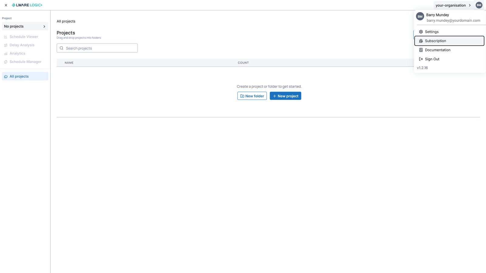
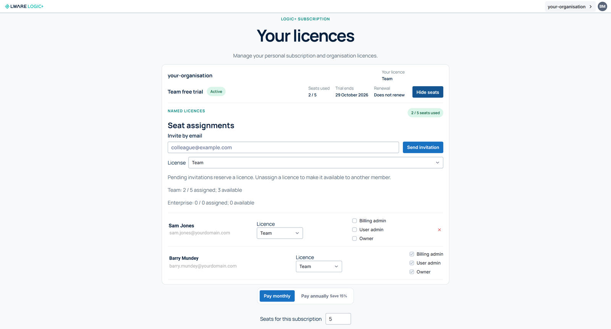

## About this page

Open **Subscription** from your profile menu (your initials, top right – below Settings) to manage your licences – route `/licensing`.

 This is the same screen a new user sees when [signing up](pages/signing-up.md), just showing your current licences instead of a plan picker.

## The licensing model

Every organisation you belong to, plus your own personal workspace, has its own licence:

- **Solo** – one named user, a private personal workspace. Independent of any organisation – buy or cancel it without affecting your organisation membership.
- **Team** and **Enterprise** – organisation plans with a fixed number of seats. Both tiers can exist in the same organisation at once (some members on Team, others on Enterprise).

Solo and Team can each be tried free for 30 days, with no card required – see [Signing Up](pages/signing-up.md). A trial shows here as, for example, **Team free trial**.

**To use Logic+ under an organisation, a member needs exactly one named role – Team Licensed User or Enterprise Licensed User – and that tier needs an active subscription.** Having an active organisation subscription alone doesn't grant access; someone still has to assign you a named licence (see [Managing seats](#managing-seats) below).

**Admin roles don't use a seat.** **Billing admin** manages billing; **User admin** manages members and licence assignments. Either can be granted to a member independently of whether they also hold a named licence.

An organisation licence also covers your personal **My Workspace** – its data stays separate from the organisation's projects.

## Your licences

For each workspace you belong to, this page shows:

| Field | Meaning |
|---|---|
| Plan | Solo, Team, or Enterprise – with "free trial" added during a trial (e.g. **Solo free trial**) |
| Status | **Active** or **Inactive** |
| Seats used | *(organisation plans only)* how many named licences are assigned, out of the total purchased |
| Trial ends / Paid through | The date your current period ends |
| Renewal | **Automatic**, **Cancels at period end**, **Does not renew** (a trial you haven't bought), or e.g. **Team starts when your trial ends** (a trial you've already bought) |

If your organisation's subscription isn't active and you're not a billing admin, you'll see a message to contact a billing admin instead of licence detail. If the organisation has an active subscription but you don't hold a named Team or Enterprise licence yourself, you'll see a message that you need one to access projects, schedules, delay analysis, and analytics – administrators still retain access to licence and seat management in that case.

## Managing billing

**Manage Solo billing** or **Manage tenant billing** opens the Stripe billing portal for that workspace, where you can update payment details, change plans, or cancel. This button only appears if you're a billing admin for that workspace, and isn't available while you're still on a trial.

## Managing seats

For an organisation plan, click **Manage seats** to open the seat assignment panel (requires the **User admin** role; click **Hide seats** to close it again). It shows:

- **Seats used** – a running count against your purchased capacity.
- **Invite by email** – enter an email address and choose a licence (**No app access**, **Team**, or **Enterprise**) to send an invitation. The licence defaults to **Team**, or to **Enterprise** if no Team seats are left. Choosing a tier reserves a seat immediately, even before the invitation is accepted.
- **Availability per tier** – how many Team and Enterprise seats are assigned versus available.
- **Member roster** – for each member: their licence (change it inline via a dropdown; a tier shows as unavailable once its seats are full unless you're changing that same member's existing licence), their **Billing admin** / **User admin** checkboxes, and whether they're the organisation **Owner**.
- **Pending invitations** – shown with their expiry date and whether they reserved a seat. Click the **✕** on an invitation to revoke it.

Untick a member's licence (**No app access**) or remove them entirely to free up a seat for someone else.

### Inviting someone

1. In **Invite by email**, enter their email address, choose their **Licence**, and click **Send invitation**.
2. The invitation appears in the member list as pending until they accept.

**What the invited person sees:**

1. An email titled **Join your workspace**, naming your workspace and the email address that was invited. They click **Accept invitation**.
2. On the **Join your workspace** screen, they log in – or create an account, or sign in with Microsoft – **using the invited email address**.
3. On **You've Been Invited!**, they click **Continue**, and they're in your organisation's workspace.

If an invitation has expired, send a new one.

Once they've joined, you can change their **Licence** or give them the **Billing admin** or **User admin** role at any time. There's only one **Owner** per organisation.

### Transferring ownership

Only the current owner can transfer ownership, via the **Owner** checkbox against another member. Confirming warns you that billing emails will move to the new owner's verified email, and that you'll remain a member but lose billing and user administration access. This can only be attempted once per session – if the outcome is unclear afterwards, contact support before trying again.

## Messages you might see

| Message | Meaning |
|---|---|
| "All purchased seats are already assigned." | Every seat in that tier is in use – free one up or purchase more before assigning another. |
| "A User_admin role is required to manage seats." | You need the User admin role to open seat management. |
| "Ownership transfer could not finish. Contact support to complete it." | The transfer didn't complete cleanly – don't retry, contact support instead. |

## If you run into trouble

Contact **support@lware.com** with any issues, questions, or feedback.
